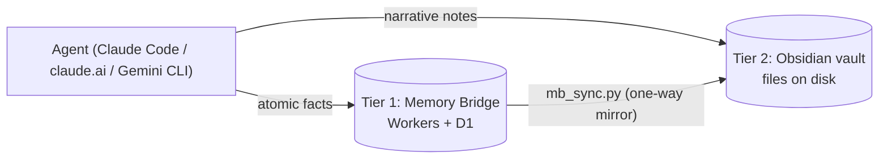

# memory-bridge-mcp


[](https://github.com/tbalt88/memory-bridge-mcp/actions/workflows/ci.yml)


*This system is part of the working record behind my [AIDLC series](https://www.linkedin.com/in/dexterdomingo/) on AI-driven development.*

A personal, cross-surface memory system exposed as a remote MCP server — reachable
from claude.ai (chat/mobile) and Claude Code (both live-verified). Cowork is currently
blocked by a bug on their end, not ours — see ARCHITECTURE.md's Surface support table.
See
[ARCHITECTURE.md](./ARCHITECTURE.md) for the current high-level system design,
[TESTING.md](./TESTING.md) for the test record and a runnable interactive test plan, and
[TDD.md](./TDD.md) for the full design rationale, decision history, and non-goals.

Built on Cloudflare Workers + D1, scaffolded from Cloudflare's official
`remote-mcp-github-oauth` template. Access is gated by GitHub OAuth plus an
allowlist of GitHub logins (`ALLOWED_USERNAMES` in `src/index.ts`) — this is a
single-user personal store, not a multi-tenant service.

### Table of Contents

- [Part of a two-tier memory architecture](#part-of-a-two-tier-memory-architecture)
- [Tools](#tools)
- [Engineering notes](#engineering-notes)
- [Agent memory: practices this system encodes](#agent-memory-practices-this-system-encodes)
- [Setup](#setup)
- [Local development](#local-development)
- [Why not Cloudflare Access as the auth gate](#why-not-cloudflare-access-as-the-auth-gate)

## Part of a two-tier memory architecture

This server is tier 1 of a two-tier personal memory system.

- **Tier 1 — Memory Bridge (this repo):** fast, atomic recall reachable from every
  surface — claude.ai, Claude Code, Gemini CLI. Answers "what is true right now."
- **Tier 2 — the vault:** an AI-operated Obsidian vault holding the narrative
  archive — daily notes, debriefs with `file:line` citations, decision history.
  Answers "what happened, and why." Its complete machinery is public at
  [second-brain-template](https://github.com/tbalt88/second-brain-template).



**The boundary rule:** the Bridge wins for "what is true right now"; the vault wins
for history and full context. An agent that finds a conflict between the two applies
this rule instead of guessing.

The author's live instance runs both tiers daily on private data; the public repos
carry the full machinery.

<p align="right">(<a href="#memory-bridge-mcp">back to top</a>)</p>

## Tools

- `memory_ping()` — zero-side-effect connectivity check, no DB access. Call first on
  any new client integration so a broken tool registration surfaces in one cheap call.
- `memory_write(content, category?, tags?, surface, session_id)` — omit `category` to
  leave the entry staged for later triage.
- `memory_search(query, tags?, surface?, status?)` — keyword filter, no embeddings in v1.
- `memory_get(id)`
- `memory_list_staged()` — the untriaged FIFO queue.
- `memory_update(id, content?, tags?, surface?)` — edits content/tags/surface only;
  tags replace, not merge. Category/status changes go through `memory_triage`.
- `memory_delete(id)` — hard delete, irreversible. `memory_triage` with `discard` is
  the reversible route.
- `memory_triage(id, category | discard)`

<p align="right">(<a href="#memory-bridge-mcp">back to top</a>)</p>

## Engineering notes

An honest account of what was inherited versus built, and the parts worth a
code-reader's attention:

- **Provenance, precisely.** The OAuth transport — `workers-oauth-utils.ts`,
  `utils.ts`, and the route skeleton of `github-handler.ts` — comes from
  Cloudflare's official template, kept deliberately: commodity auth is not where a
  memory system differentiates. Everything memory is original: the eight-tool
  surface (`src/memory.ts`, `src/index.ts`), the D1 schema and its
  staged → active/archived lifecycle (`migrations/0001_init.sql`), the allowlist
  gate, the test suite, and all four documents. The commit history discloses which
  is which from the first commit message onward.
- **`memory_ping` exists because of a real bug.** Integrating Gemini CLI surfaced a
  silent tool-registration failure: the client reported connected while every real
  tool call failed identically (TDD.md §12.16). The response was API design — a
  zero-side-effect connectivity check, so any new client integration fails in one
  cheap call instead of partway through a real write. It has been the first call on
  every new surface since.
- **Tests run against real D1, not mocks.** The 18 Vitest cases execute against a
  Miniflare-backed D1 binding via `@cloudflare/vitest-pool-workers`, chosen over
  mocking specifically because a mocked database cannot catch SQL-shape mistakes
  (TDD.md §12.9–12.10, TESTING.md).
- **More documentation than code.** Roughly 1,400 lines of docs against roughly 700
  lines of memory-system TypeScript: ARCHITECTURE.md for the current design,
  TESTING.md for the verified test record, TDD.md for every decision, rejected
  alternative, and numbered pitfall. The repo is meant to be auditable, not just
  runnable.
- **Surface support is reported honestly.** claude.ai and Claude Code are
  live-verified. Gemini CLI was tested and produced the bug above. Cowork is
  blocked by a documented bug on their side — reported as blocked, not glossed
  into a fourth green checkmark.

<p align="right">(<a href="#memory-bridge-mcp">back to top</a>)</p>

## Agent memory: practices this system encodes

Opinionated, and each one is running here, not proposed. Some are enforced by the
server; the rest are operating rules its clients follow — the split is marked,
because a practice that lives in a prompt is a different guarantee than one that
lives in code.

1. **Separate "true now" from "what happened," and give agents a deterministic
   conflict rule.** One tier for atomic current facts (this server), one for
   narrative history (the vault). When they disagree, the boundary rule decides —
   an agent should never improvise epistemology mid-task. *(Architecture.)*
2. **Stage, don't guess.** A write without a confident category lands in a staging
   queue (`status: staged`) for explicit triage later. An agent that guesses
   categories at write time pollutes the store silently; a staging queue makes
   uncertainty visible and reviewable. *(Server-enforced: `memory_write` without
   `category` stages automatically.)*
3. **Reversible by default, destructive by exception.** Triage-discard archives;
   nothing is lost. Hard delete exists (`memory_delete`) but is documented as the
   marked, deliberate path — and client operating rules require owner confirmation
   before it. *(Server provides both; the confirmation rule is client-side.)*
4. **A memory is a claim about when it was written, not a permanent truth.** Every
   entry carries provenance — surface, session id, timestamps — and readers verify
   currency before acting on anything consequential. Trust, not blind recall.
   *(Schema-enforced provenance; verification is a client operating rule.)*
5. **Search before write.** Near-duplicates accumulate silently in any append-only
   store; the rule is search first, prefer `memory_update` over a fresh write when
   a close match exists. *(Client operating rule.)*
6. **Fail cheap on integration.** A memory system spanning multiple clients needs a
   zero-side-effect liveness check (`memory_ping`), because tool registration can
   fail silently while the connection reports healthy — observed in production, not
   hypothesized. *(Server-enforced; born from TDD.md §12.16.)*
7. **Write less, deliberately.** Durable facts, decisions, and preferences — not
   transcripts, not task-local ephemera. A store optimized for recall degrades with
   every entry that will never matter again. *(Client operating rule.)*
8. **The store answers; it does not decide.** Recall informs the agent's judgment,
   and the human owns anything irreversible. Memory infrastructure that quietly
   drives actions is an authorization problem wearing a persistence costume.
   *(Design stance, enforced by the allowlist and the client rules above.)*

<p align="right">(<a href="#memory-bridge-mcp">back to top</a>)</p>

## Setup

### 1. GitHub OAuth App

Create an [OAuth App](https://docs.github.com/en/apps/oauth-apps/building-oauth-apps/creating-an-oauth-app):

- Homepage URL: `https://<worker-name>.<subdomain>.workers.dev`
- Callback URL: `https://<worker-name>.<subdomain>.workers.dev/callback`

Then set the secrets:

```bash
wrangler login
wrangler secret put GITHUB_CLIENT_ID
wrangler secret put GITHUB_CLIENT_SECRET
wrangler secret put COOKIE_ENCRYPTION_KEY   # e.g. openssl rand -hex 32
```

### 2. KV namespace (OAuth state) and D1 database (memory storage)

```bash
wrangler kv namespace create "OAUTH_KV"
wrangler d1 create memory-bridge-db
```

Copy the returned IDs into `wrangler.jsonc` (`<Add-KV-ID>` and `<Add-D1-ID>`), then
apply the schema:

```bash
wrangler d1 migrations apply memory-bridge-db --remote
```

### 3. Deploy

```bash
npm run deploy
```

### 4. Connect

- **claude.ai**: Settings → Connectors → Add custom connector →
  `https://<worker-name>.<subdomain>.workers.dev/mcp`
- **Claude Code**: `claude mcp add --transport http memory-bridge https://<worker-name>.<subdomain>.workers.dev/mcp`
- **Cowork**: check its settings for the same custom-connector-by-URL mechanism —
  unconfirmed as of this writing, see TDD.md §10.

<p align="right">(<a href="#memory-bridge-mcp">back to top</a>)</p>

## Local development

Create a second, separate GitHub OAuth App pointed at `http://localhost:8788` /
`http://localhost:8788/callback`, then a `.dev.vars` file (gitignored):

```
GITHUB_CLIENT_ID=...
GITHUB_CLIENT_SECRET=...
COOKIE_ENCRYPTION_KEY=...
```

Apply migrations locally and run the dev server:

```bash
wrangler d1 migrations apply memory-bridge-db --local
npm run dev
```

Inspect with the [MCP Inspector](https://modelcontextprotocol.io/docs/tools/inspector):
`npx @modelcontextprotocol/inspector@latest`, pointed at `http://localhost:8788/mcp`.

<p align="right">(<a href="#memory-bridge-mcp">back to top</a>)</p>

## Why not Cloudflare Access as the auth gate

Considered and rejected: Cloudflare Access as an SSO wall in front of the route has a
documented, open failure against claude.ai's web/mobile MCP connector
([anthropics/claude-ai-mcp#410](https://github.com/anthropics/claude-ai-mcp/issues/410)).
The Worker-embedded OAuth provider (this template's approach) is what claude.ai's
connector is actually designed to drive. Details in [TDD.md](./TDD.md) §5.
